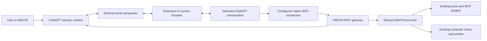

# ChatGPT browser integration for ANKITA

Status: proposed design for review; research and planning only.
Date: 2026-10-12, Asia/Calcutta.

## User intent and confirmed choice

Use ChatGPT in the browser as ANKITA's conversation/model runtime, while retaining
ANKITA's desktop interface, projects, tools, computer-use pointer and existing providers.
Reuse Chat On Steroids (CoS) where it helps instead of building the browser integration
from scratch. The user explicitly chose **the browser already open**, replacing the
earlier proposed dedicated Chrome window. Attach to a selected signed-in ChatGPT tab;
do not restart Chrome, migrate its profile or open replacement chats during recovery.

Success is an observed round trip: send from ANKITA, receive the reply in ANKITA, run
an existing ANKITA tool through ChatGPT's native MCP connection, read its real result,
and stop without replaying work or closing the person's browser/apps.

## Research snapshot

- Source: https://github.com/totec448-spec/chat-on-steroids
- Pinned revision: `34f4b73cc242b63acd4be5ba4e4fb74a5cdb99e5`.
- Package reports `2.1.34`, MIT. This is a research pin, not a production version default.
- Source-only sparse checkout: `C:/Users/anime/.codex/visualizations/2026/10/10/01a12696-6960-7472-bff9-debac1d47dae/references/chat-on-steroids-source`.
- ANKITA committed baseline: `a31c8829e3c8eda090f143d93901a3a4b3c6c701`.
  Existing uncommitted user edits are outside this proposal and must be preserved.

The original full clone stalled. An HTTP/1.1 filtered sparse clone completed and its
HEAD matches the research pin. No upstream install script, binary or app was executed.

## What CoS actually provides

| Capability | Inspected source | Consequence for ANKITA |
| --- | --- | --- |
| Current-browser companion | `extension/manifest.json`, `src/main/browser.ts` | Conversation control uses an installed extension and the normal signed-in browser profile. A global remote-debugging port is not required for this path. |
| Composer and completion evidence | `extension/chatgpt-dom.js`, `extension/fiber.js`, `extension/content.js` | Reuse tested page adapters and receipt rules; silence or interim prose cannot mean completion. |
| Extension/app bridge | `extension/background.js`, `src/main/bridge.ts`, `src/shared/browser-bridge.ts` | Separate authenticated loopback observation/command traffic from cloud-facing MCP tool traffic. |
| Native ChatGPT tools | `src/main/mcp/server.ts`, `tools.ts`, `tools-plugins.ts`, `inbound.ts` | ChatGPT calls MCP directly; this is not an OpenAI-compatible model endpoint. |
| Account model discovery | `src/main/chat-models.ts` | Populate models from fresh browser observations and confirm selection before Send. |
| Delivery and durable recovery | `src/main/session/input.ts`, `correlation.ts`, `continuation.ts`, `finish.ts` | Preserve command identity, source conversation and uncertain outcomes across reloads. |
| Local tool reachability | `src/main/tunnel/index.ts` | CoS supports OpenAI Secure MCP Tunnel and a public HTTPS tunnel alternative; their credentials/exposure differ. |
| Goal helper | `src/main/goal.ts`, `src/shared/types.ts` | The shipped Goal helper defaults to OpenRouter and also supports custom providers. Porting it wholesale would add another model-provider dependency. |

The README explicitly says normal account model availability, usage and context limits
apply. It does not promise unlimited GPT-6. Model names must come from the connected
account, and a limit/refusal must remain a limit/refusal. Official documentation also
says supported ChatGPT-plan app connections use the existing plan allowance.

Sources: [CoS README](https://github.com/totec448-spec/chat-on-steroids/blob/34f4b73cc242b63acd4be5ba4e4fb74a5cdb99e5/README.md),
[official plan usage](https://learn.chatgpt.com/docs/sign-in-with-chatgpt),
[official plugin controls](https://learn.chatgpt.com/docs/enterprise/apps-and-connectors).

## Comparison with current ANKITA

| Area | Current ANKITA | Proposed integration |
| --- | --- | --- |
| Model runtime | `bootstrap.mjs` creates API clients; `Agent.streamAttempt` posts `/chat/completions`. | Add a distinct desktop ChatGPT-session runtime; retain the API route. |
| Tools | Native registry plus external MCP clients; `Agent.runToolCall/runMcpToolCall` own approval and execution. | Publish selected existing capabilities through inbound MCP; share execution authority rather than invoking raw handlers. |
| Chrome | Browser tools attach through chrome-devtools-mcp; mascot helper captures webpage content. | A separate ChatGPT companion observes only explicitly bound ChatGPT tabs. Keep model tabs outside ordinary browser-action discovery. |
| Desktop activity | Engine events already drive messages, tool cards, file changes and the island. | Map browser observations and real MCP execution receipts into those events. |
| Stop and pointer | Engine cancellation and `DesktopComputerUse` already own tool cancellation and pointer sessions. | Reuse them; stop both browser generation and local accepted work while preserving user apps. |
| History | Session persistence and secret scrubbing already exist. | Add browser IDs/operation receipts; reuse history presentation and scrubbing. |

This cannot be implemented by putting `chatgpt.com` into Custom API settings.
It also must not parse browser prose as executable function calls. ChatGPT remains
the model-side orchestrator in this mode; MCP remains the action channel.

## Approaches and recommendation

1. **Focused external companion plus ANKITA MCP gateway — recommended.** Keep browser
   transport in an external service, port CoS's relevant MIT adapters/receipt tests,
   and expose ANKITA's existing tools. More initial seam work, but one desktop interface
   and one execution policy. First prove a single-tab native MCP round trip.
2. **Run full CoS alongside ANKITA.** Fastest reference experiment, but two apps,
   duplicated tool/desktop control and a second session store. Suitable for a proof,
   not the intended final ANKITA experience.
3. **Official ChatGPT-plan sign-in or a Responses API provider.** A separate future
   route. ANKITA's eligibility for plan usage is unproven, and an API provider has
   different authentication and usage. GPT-6 API tool calling also needs the documented
   Responses path rather than assuming the existing Chat Completions tool contract.

Do not transplant CoS's entire app. Its `bridge.ts` exceeds ten thousand lines and
imports goals, agents, projects, recorder and continuation state. Its plugin/core
handlers also own a separate filesystem/process runtime. A focused fork of page
adapters plus shared receipt rules is the reusable boundary; extraction is real work.

## Proposed architecture

There is no second `Agent.send` loop for browser-mode messages. API messages continue
through the existing agent. The gateway invokes a shared ToolHost extracted from
current tool execution, including its prepare/recheck, cancellation, permissions,
workspace and observation guards. It returns native MCP text/image content instead
of appending images to an API request that does not exist.

Use a small initial Core surface, then Desktop and enabled Plugins surfaces as
separate publications. Derive their schemas from the live ANKITA registry and vetted
connected services. Do not expose settings mutation or unrestricted profile access.

## Boundaries and invariants

- Explicit Connect selects an existing ChatGPT tab and its conversation. No browser
  launch, cookie transfer, login automation or global debugging port is part of this mode.
- An installed companion is a prerequisite. Account/workspace custom MCP availability
  and a real cloud-to-local tool round trip are separate prerequisites for action mode.
- MVP supports one active browser conversation. Multi-tab teammates remain on API
  providers until isolation is proven; concurrent ChatGPT workers are a later phase.
- The companion service binds loopback, checks paired extension identity, versions,
  Origin, Host and body bounds. It cannot itself execute files/shell/desktop actions.
- MCP transport has distinct credentials and admission. Prefer a supported Secure MCP
  Tunnel after eligibility testing; its control-plane credentials are not model inference
  credentials. A public tunnel is a separate explicit setup choice with its own secret.
- A tool call requires an active desktop lease, allowed capability and exact observed
  request/conversation attribution. Reused/ambiguous `x-request-id` values do not grant
  another workspace. Missing attribution waits within a configured bound, then refuses.
- Persist an operation before offering it. Distinguish queued, claimed, dispatched,
  accepted, completed, stopped, rejected and uncertain. Reload is not failure or completion.
- Deduplicate exact authenticated operation IDs and identical arguments. A changed
  payload under the same ID is an error. New IDs are new requests: never claim transport
  deduplication prevents every semantic duplicate a model could request.
- Do not automatically replay ambiguous Send, shell or file mutations after disconnect.
  Settle/read back the existing operation before allowing dependent recovery actions.
- User Stop cancels pending sends, browser generation and scoped local work. No automatic
  revival follows it. Stale page observations cannot restart a cancelled generation.
- Preserve foreground computer-use no-prompt behavior and explicit blocked tiers through
  the existing host; ChatGPT's own connection permissions remain separate controls.
- Observed model choices and usage belong to the current binding. Unknown usage stays
  unknown; no fabricated zero-cost, unlimited, token count or automatic model downgrade.
- Only bound conversation content is recorded; browser-wide history import is not implied.
  Use ANKITA secret scrubbing and encrypted storage; never send pairing/tunnel credentials
  into prompts, transcripts or logs.
- New protocol literals, paths, limits and polling intervals live in named shared config
  with units/reasons. Generate extension/host values from it instead of duplicating literals.
- No dependency is installed during planning. Review future MCP SDK, DOM-test and tunnel
  dependencies using the Sonatype skill before adding them; preserve MIT notices and
  separately inspect third-party components. Do not import upstream assets/native drivers.

## Delivery order and acceptance

1. Publish a read-only ANKITA MCP surface and prove its protocol using a real local MCP
   client and a unique temporary file. Preserve existing API tool-policy behavior.
2. Bind the extension to the existing browser, discover available models and observe a
   selected chat. Then prove ChatGPT reads that temporary file through native MCP with
   exact source attribution. If the account cannot use a native MCP connection, action
   mode stops here visibly, before desktop runtime changes. Reuse the DOM adapter and
   completion evidence; test offline fixtures alongside that hosted-model proof.
3. Send a unique question from ANKITA and receive its accepted user message, streaming
   answer and final receipt. Prove reload and lost-ack behavior before adding writes.
4. Connect the desktop session mode and full permitted ToolHost. Read/edit/read back a
   unique file and run a bounded real command through native MCP; receipts appear in ANKITA.
5. Add Stop, attachment/image delivery, restart recovery and explicit context handoff.
   Only user-approved unfinished work can continue; account restrictions halt execution.
6. Verify existing API providers, both browser backends and Cua pointer behavior; build
   and test the packaged desktop with the already-open Chrome profile.

First shipping milestone: one existing ChatGPT conversation controlled from ANKITA,
one real native MCP read, one bounded edit with readback, visible tool results, and Stop.
Goal automation, code-mode batching and concurrent workers follow that milestone;
none is required to make ordinary browser-mode chat work.

## Evidence still required

No live account/browser/MCP round trip was attempted for this planning request. Model
availability, connector permissions, tunnel eligibility and current DOM/Fiber compatibility
are not established. Upstream and ANKITA tests were not executed; no product code changed.
The implementation plan puts live account proof ahead of broad runtime investment.
